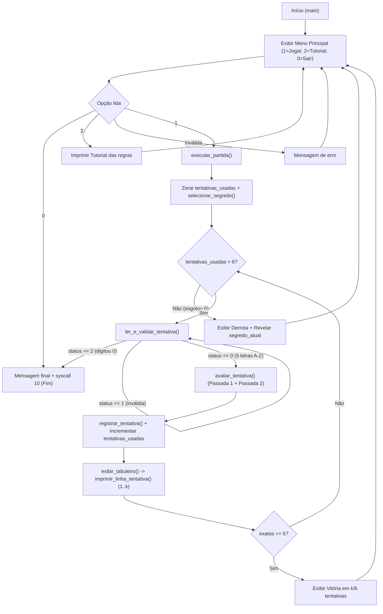

# 02 — Plano Técnico e Arquitetura MIPS (`TERMO-MIPS`)

Este documento define **COMO** o produto especificado em `01-spec.md` será implementado em Assembly MIPS para o simulador MARS, sem código `.asm` final, estabelecendo contratos exatos de memória, registradores, pilha, algoritmos e testes calculados à mão.

---

## 1. Organização de Arquivos de Código

- **Arquivo único:** `src/termips.asm` (ver `ADR-006`).
- **Justificativa:** Evita erros de montagem no MARS por esquecimento da flag *"Assemble all files in directory"* (`RT-01`), facilita inspeção do segmento `.data`/`.text` no vídeo (`RNF-04`) e mantém todo o contexto visível para estudo do grupo (`RNF-01`).

---

## 2. Layout Completo do Segmento `.data`

> **Regra crítica de alinhamento:** Todas as variáveis `.word` (4 bytes) vêm **no topo** do segmento `.data` (iniciado em `0x10010000`, já alinhado em múltiplo de 4), antes de qualquer `.space` ou `.asciiz` de tamanho não múltiplo de 4.

| Rótulo | Diretiva / Tamanho | Alinhamento / Endereço Relativo | Papel no Estado / Lógica |
| :--- | :--- | :--- | :--- |
| `num_palavras` | `.word 200` (4 B) | `0x10010000` (alinhado 4 B) | Quantidade total `N` de palavras no `banco_palavras` (limite superior da `syscall 42`). |
| `max_tentativas` | `.word 6` (4 B) | `+4` (alinhado 4 B) | Limite máximo de tentativas válidas por partida. |
| `usar_palavra_fixa` | `.word 0` (4 B) | `+8` (alinhado 4 B) | Flag interna p/ testes reproduzíveis (Seção 6): `0` = sorteio normal; `1` = usa `indice_fixo` (fora do menu do jogador). |
| `indice_fixo` | `.word 0` (4 B) | `+12` (alinhado 4 B) | Índice usado quando `usar_palavra_fixa == 1` (`0` → `"TERMO"`). |
| `tentativas_usadas` | `.word 0` (4 B) | `+16` (alinhado 4 B) | **Estado mutável:** contador de tentativas válidas já realizadas na partida atual (`0..6`). |
| `segredo_atual` | `.space 6` (6 B) | Bytes | **Estado mutável:** cópia da palavra secreta da partida atual (5 bytes `A-Z` + `\0`). |
| `segredo_temp` | `.space 6` (6 B) | Bytes | Buffer descartável usado por `avaliar_tentativa` para consumir letras (`'*'`) nas duas passadas sem destruir `segredo_atual`. |
| `tentativa_atual` | `.space 6` (6 B) | Bytes | Última tentativa validada e normalizada em maiúsculas (5 bytes `A-Z` + `\0`). |
| `status_atual` | `.space 6` (6 B) | Bytes | Resultado da rodada atual: 5 bytes com códigos `2` (exato), `1` (presente), `0` (ausente) + padding. |
| `historico_palavras` | `.space 36` (6 × 6 B) | Matriz linearizada (`base + 6*k`) | **Estado mutável (`RT-04`, `RT-09`):** armazena as até 6 palavras tentadas (`5 letras + \0` cada). |
| `historico_status` | `.space 36` (6 × 6 B) | Matriz linearizada (`base + 6*k`) | **Estado mutável (`RT-04`, `RT-09`):** armazena os vetores de status das até 6 tentativas (stride 6 idêntico ao de palavras para simplificar cálculo de índice!). |
| `buf_entrada` | `.space 64` (64 B) | Bytes | Buffer bruto da `syscall 8` (`$a1 = 64`), absorvendo o `\n` e detectando entradas longas (> 5 chars). |
| `banco_palavras` | 200 linhas `.asciiz "XXXXX"` (1200 B) | Contíguo (`banco_palavras + 6*i`) | **Estrutura de dados (`RT-04`):** 200 palavras de 5 letras ASCII maiúsculas sem acento. Índice `0` = `"TERMO"`, índice `1` = `"CARTA"`, ..., índice `199`. |
| `fim_banco` | Rótulo marcador | `banco_palavras + 1200` | Rótulo imediatamente após a última palavra para conferência rápida (`fim_banco - banco_palavras == 1200`). |
| `msg_*` | Strings `.asciiz` | Bytes (final do `.data`) | Mensagens de menu, prompt de tentativa, erros específicos (tamanho, caractere inválido, opção inválida), vitória, derrota e saída. |

---

## 3. Tabela de Procedimentos e Contratos de Registradores / Pilha

Planejamos **8 unidades (`main` + 7 procedimentos)** — superando com folga o mínimo de 3 procedimentos (`RT-05`) e mantendo cada um enxuto (~16 a 46 instruções) para a prova individual.

| Procedimento | Responsabilidade Única | Parâmetros (`$a0–$a3`) | Retorno (`$v0–$v1`) | Registradores Usados | Salvo em `$sp` e Justificativa (`RT-06`, `RT-07`) |
| :--- | :--- | :--- | :--- | :--- | :--- |
| `main` | Exibe o menu principal (`1=Jogar`, `2=Tutorial`, `0=Sair`), imprime o texto do tutorial quando solicitado, invoca `executar_partida` ou encerra com `syscall 10`. | Nenhum | Não retorna (`syscall 10`) | `$t0–$t2`, `$a0–$a1`, `$v0` | **0 bytes.** Ponto de entrada raiz; não possui chamador acima dele. |
| `executar_partida` | Coordena o ciclo de vida de uma partida: zera estado, seleciona segredo, executa o laço de até 6 tentativas válidas, verifica vitória/derrota/saída. | Nenhum | `$v0`: `1` (vitória), `0` (derrota), `-1` (usuário digitou `0` para sair) | `$s0` (rodada `0..5`), `$s1` (acertos exatos), `$t0–$t2` | **12 bytes (`$ra`, `$s0`, `$s1`).** Procedimento **não-folha**: chama 5 procedimentos via `jal` dentro de um laço e precisa preservar `$ra` e o estado da partida através das chamadas. |
| `selecionar_segredo` | Lê `usar_palavra_fixa`: se `0`, sorteia índice via `syscall 42` (lendo `$a0`); se `1`, lê `indice_fixo`; calcula `banco_palavras + 6*i` e copia 6 bytes para `segredo_atual`. | Nenhum | `$v0`: índice escolhido (`0..N-1`) | `$t0–$t4`, `$a0–$a1`, `$v0` | **0 bytes.** Procedimento **folha** que usa apenas temporários `$t0–$t4` (não faz `jal` nem altera `$s`). |
| `ler_e_validar_tentativa` | Imprime prompt `k/6`, lê linha (`syscall 8`), detecta saída (`'0'`), valida tamanho `== 5` e faixa `A-Z` (normalizando `a-z → A-Z`) e grava em `tentativa_atual`. | `$a0`: end. de `tentativa_atual`<br>`$a1`: nº da tentativa (`1..6`) | `$v0`: `0` (válida), `1` (inválida), `2` (comando `0` sair) | `$s0` (ponteiro destino), `$s1` (nº tentativa), `$t0–$t5` | **8 bytes (`$s0`, `$s1`).** Folha com múltiplas `syscall` (`4`, `1`, `8`) que sobrescrevem `$a0`, `$a1` e `$v0`; salva `$s0–$s1` para respeitar o contrato *callee-saved* de `executar_partida`. |
| `avaliar_tentativa` | Executa o algoritmo de duas passadas comparando `tentativa` e `segredo` via `segredo_temp`, preenchendo `status` (`2`, `1`, `0`) e contando acertos. | `$a0`: end. `tentativa`<br>`$a1`: end. `segredo`<br>`$a2`: end. `status` | `$v0`: qtd. exatos (`0..5`)<br>`$v1`: qtd. presentes (`0..5`) | `$t0–$t8` (índices `i`, `j`, ponteiros em `segredo_temp`, bytes comparados) | **0 bytes** (ou opcionalmente `$s` se desejado; como folha pura sem `jal` nem `syscall`, `$a0–$a2` permanecem intactos e `$t0–$t8` bastam — zero uso artificial de pilha!). |
| `registrar_tentativa` | Grava a palavra validada e seu vetor de status na linha `k` (`base + 6*k`) de `historico_palavras` e `historico_status`, atualizando `tentativas_usadas`. | `$a0`: índice `k` (`0..5`)<br>`$a1`: end. `tentativa_atual`<br>`$a2`: end. `status_atual` | Nenhum | `$t0–$t5` | **0 bytes.** Procedimento **folha puro**, rápido e determinístico. |
| `exibir_tabuleiro` | Percorre `m = 0 .. tentativas_usadas - 1` invocando `imprimir_linha_tentativa` para renderizar o histórico acumulado da partida. | `$a0`: total de linhas a exibir (`1..6`) | Nenhum | `$s0` (índice `m`), `$s1` (limite total), `$t0–$t1` | **12 bytes (`$ra`, `$s0`, `$s1`).** Procedimento **não-folha**: executa `jal imprimir_linha_tentativa` dentro de um laço `for`, exigindo salvar `$ra` e o contador/limite do laço em `$s0–$s1`. |
| `imprimir_linha_tentativa` | Formata e imprime uma única linha `[m/6] PALAV -> [X] (Y)  .  ...` lendo os 5 caracteres e os 5 códigos de status da rodada `m`. | `$a0`: end. palavra `m`<br>`$a1`: end. status `m`<br>`$a2`: número humano `m+1` (`1..6`) | Nenhum | `$s0` (end. palavra), `$s1` (end. status), `$s2` (índice `i=0..4`), `$t0–$t2` | **12 bytes (`$s0`, `$s1`, `$s2`).** Realiza diversas `syscall 4`, `1` e `11` dentro de laço de 5 colunas que sobrescrevem `$a0` e `$v0`; preserva os ponteiros e contador em `$s0–$s2`. |

---

## 4. Pseudocódigo dos Algoritmos Centrais (Estilo C, sem MIPS)

### 4.1 Validação e Normalização de Entrada (`ler_e_validar_tentativa`)

```c
// Retorna: 0 = tentativa valida, 1 = entrada invalida, 2 = comando sair ('0')
int ler_e_validar_tentativa(char destino[6], int num_tentativa) {
    imprimir_prompt(num_tentativa);          // "Tentativa X/6 (ou 0 para sair): "
    ler_string_console(buf_entrada, 64);     // syscall 8: mantem '\n' se < 63 chars

    // 1. Verificar comando de saida imediata: '0' seguido de fim de linha
    if (buf_entrada[0] == '0' &&
        (buf_entrada[1] == '\n' || buf_entrada[1] == '\r' || buf_entrada[1] == '\0')) {
        return 2;
    }

    // 2. Medir comprimento util antes de '\n', '\r' ou '\0'
    int tam = 0;
    while (buf_entrada[tam] != '\0' && buf_entrada[tam] != '\n' && buf_entrada[tam] != '\r') {
        tam++;
    }

    if (tam != 5) {
        imprimir_erro_tamanho(tam);          // Informa quantos caracteres foram lidos
        return 1;
    }

    // 3. Validar alfabeto ASCII e normalizar minusculas -> maiusculas
    for (int i = 0; i < 5; i++) {
        char c = buf_entrada[i];
        if (c >= 'a' && c <= 'z') {
            c = c - 32;                      // Converte para 'A'..'Z'
        }
        if (c < 'A' || c > 'Z') {
            imprimir_erro_caractere();       // Rejeita digitos, simbolos e bytes UTF-8
            return 1;
        }
        destino[i] = c;
    }
    destino[5] = '\0';
    return 0;
}
```

### 4.2 Avaliação em Duas Passadas para Letras Repetidas (`avaliar_tentativa`)

```c
// status[i]: 2 = posicao exata [X], 1 = outra posicao (X), 0 = ausente .
// Retorna (exatos em $v0, presentes em $v1)
ParContagem avaliar_tentativa(const char tentativa[5], const char segredo[5], char status[5]) {
    int exatos = 0;
    int presentes = 0;

    // Preparacao: copiar segredo para segredo_temp e zerar status
    for (int i = 0; i < 5; i++) {
        segredo_temp[i] = segredo[i];
        status[i] = 0;
    }

    // PASSADA 1: Marcar posicoes exatas primeiro e consumir letra no segredo_temp
    for (int i = 0; i < 5; i++) {
        if (tentativa[i] == segredo_temp[i]) {
            status[i] = 2;
            segredo_temp[i] = '*';           // Consome para nao reutilizar na Passada 2
            exatos++;
        }
    }

    // PASSADA 2: Para posicoes nao-exatas, buscar sobra disponivel em segredo_temp
    for (int i = 0; i < 5; i++) {
        if (status[i] != 2) {                // Pula posicoes ja cravadas na Passada 1
            for (int j = 0; j < 5; j++) {
                if (tentativa[i] == segredo_temp[j]) {
                    status[i] = 1;
                    segredo_temp[j] = '*';   // Consome esta ocorrencia especifica
                    presentes++;
                    break;                   // Essencial: uma letra do palpite consome so 1 do segredo!
                }
            }
        }
    }

    return (ParContagem){ exatos, presentes };
}
```

---

## 5. Fluxo Geral do Programa



---

## 6. Localização dos Requisitos Técnicos Obrigatórios no Código

| Requisito | Onde será atendido em `src/termips.asm` |
| :--- | :--- |
| **RT-01** (MARS) | Arquivo único compatível com configuração padrão do MARS 4.5 (sem MMIO nem flags especiais). |
| **RT-02** (E/S coerente) | `main` (menu), `ler_e_validar_tentativa` (`syscall 8`), `imprimir_linha_tentativa` (`syscall 4, 1, 11`). |
| **RT-03** (Decisões e laços) | Laço de turnos em `executar_partida`; varredura/validação em `ler_e_validar_tentativa`; laços `Passada 1` e `Passada 2` aninhados em `avaliar_tentativa`; laço de histórico em `exibir_tabuleiro`. |
| **RT-04** (Vetor/matriz/string) | `banco_palavras` (vetor de 200 strings `6*i`), `historico_palavras` e `historico_status` (matrizes `6x6`), `segredo_temp` e `status_atual` (vetores de 5/6 bytes). |
| **RT-05** (>= 3 procedimentos) | 7 procedimentos bem definidos além de `main` (`executar_partida`, `selecionar_segredo`, `ler_e_validar_tentativa`, `avaliar_tentativa`, `registrar_tentativa`, `exibir_tabuleiro`, `imprimir_linha_tentativa`). |
| **RT-06** (Parâmetros/retorno/`$s`) | Uso estrito de `$a0–$a2`, retornos em `$v0–$v1` e preservação *callee-saved* de `$s0–$s2` nos 4 procedimentos que os utilizam. |
| **RT-07** (Pilha justificada) | Quadros de pilha em `executar_partida` (16 B, salva `$ra, $s0–$s2`), `exibir_tabuleiro` (12 B, salva `$ra, $s0–$s1`), `ler_e_validar_tentativa` (8 B, salva `$s0–$s1`) e `imprimir_linha_tentativa` (12 B, salva `$s0–$s2`). |
| **RT-08** (Inválidas + saída) | Tratamento de opção inválida em `main`, tamanho `!= 5` e não-letras em `ler_e_validar_tentativa` (sem gastar tentativa), e saída imediata com `0` -> `syscall 10`. |
| **RT-09** (Estado mutável + >= 2 ações) | Ações combinadas: validar/normalizar → avaliar em duas passadas → gravar no histórico. Estado mutável: `tentativas_usadas`, `segredo_atual`, `historico_palavras` e `historico_status`. |
| **RT-10** (>= 100 instruções úteis) | ~230 instruções úteis naturais (estimativa detalhada na Seção 7 abaixo). |

---

## 7. Estimativa de Linhas Úteis de Instruções MIPS (Comparação com RT-10)

> Regra de contagem do enunciado (Seção 3, linha 55): *1 instrução ou pseudoinstrução por linha; excluem-se comentários, linhas em branco, rótulos isolados, diretivas e `.data`.*

| Unidade / Procedimento | Faixa Estimada de Instruções Úteis | Papel Principal |
| :--- | :---: | :--- |
| `main` | 24 – 30 | Menu inicial, leitura de opção, despacho e `syscall 10` |
| `executar_partida` | 35 – 42 | Controle de estado, laço de 6 rodadas, vitória/derrota |
| `selecionar_segredo` | 18 – 24 | `syscall 42` (`$a0`) / `indice_teste`, cálculo `6*i` e cópia de 6 bytes |
| `ler_e_validar_tentativa` | 40 – 48 | `syscall 8`, detecção de `'0'`, contagem de tamanho, `a-z → A-Z`, validação |
| `avaliar_tentativa` | 42 – 50 | Cópia p/ `segredo_temp`, Passada 1 (exatos) e Passada 2 (presentes com `break`) |
| `registrar_tentativa` | 14 – 18 | Escrita indexada `base + 6*k` nas matrizes de histórico e incremento de estado |
| `exibir_tabuleiro` | 16 – 20 | Prólogo/epílogo com `$ra` e laço sobre `historico_*` |
| `imprimir_linha_tentativa` | 28 – 34 | Formatação `[k/6] PALAV -> [X] (Y)  . ` no console |
| **Total Estimado (MVP)** | **217 – 266 instruções úteis** | **~2,2x acima do mínimo de 100 (`RT-10`), zero código artificial** |

---

## 8. Estratégia de Testes: 3 Casos Obrigatórios Calculados à Mão (Seção 6)

Todos os 3 casos usam a flag interna `usar_palavra_fixa = 1` e `indice_fixo = 0` (`segredo_atual = "TERMO"`) em `.data`, garantindo 100% de reprodutibilidade (Seção 6) sem alterar o menu do jogador.

### CT-01 — Caso Normal (Tutorial, Normalização, Letras Repetidas nas 2 Passadas e Vitória)
- **Ações (entradas em sequência):** Menu `2` (Tutorial) → Menu `1` (Jogar) → `"casas"` → `"morro"` → `"TRAMO"` → `"termo"` → Menu `0`.
- **Cálculo manual passo a passo contra `"TERMO"` (`T=0, E=1, R=2, M=3, O=4`):**
  1. `"casas"` → normaliza `"CASAS"`. Passada 1: 0 exatos (`segredo_temp = "TERMO"`). Passada 2: nenhuma letra de `C,A,S,A,S` ocorre em `"TERMO"`.
     - **Saída esperada:** `[1/6] CASAS ->  .   .   .   .   . ` (`$v0=0, $v1=0`).
  2. `"morro"` → normaliza `"MORRO"`.
     - Passada 1: `i=2 ('R'=='R')` → `status[2]=2`, `segredo_temp[2]='*'`; `i=4 ('O'=='O')` → `status[4]=2`, `segredo_temp[4]='*'`. Resta `segredo_temp = "TE*M*"`.
     - Passada 2: `i=0 ('M')` casa com `j=3` → `status[0]=1`, `segredo_temp="TE***"`; `i=1 ('O')` não acha `'O'` restante → `status[1]=0`; `i=3 ('R')` não acha `'R'` restante → `status[3]=0`.
     - **Saída esperada:** `[2/6] MORRO -> (M)  .  [R]  .  [O]` (`$v0=2, $v1=1`).
  3. `"TRAMO"` → Passada 1 crava `T` (0), `M` (3), `O` (4) → `segredo_temp = "*ER**"`. Passada 2 casa `R` (1) com `j=2` → `(R)`; `A` (2) → `.`.
     - **Saída esperada:** `[3/6] TRAMO -> [T] (R)  .  [M] [O]` (`$v0=3, $v1=1`).
  4. `"termo"` → normaliza `"TERMO"`. Passada 1 crava as 5 posições (`$v0=5, $v1=0`).
     - **Saída esperada:** `[4/6] TERMO -> [T] [E] [R] [M] [O]` + mensagem `"PARABENS! Codigo descoberto em 4/6 tentativas!"` + retorno ao menu.

### CT-02 — Caso de Entradas Inválidas (Preservação do Contador de Tentativas)
- **Ações:** Menu `9` (inválida) → Menu `1` (Jogar) → `""` (apenas Enter) → `"sol"` → `"bananas"` → `"ca5a!"` → `"TERMO"` → Menu `0`.
- **Resultado esperado:**
  - Menu `9`: rejeitado com aviso; permanece no menu.
  - `""` (`tam = 0`), `"sol"` (`tam = 3`), `"bananas"` (`tam = 7`): rejeitados por tamanho `!= 5`; `tentativas_usadas` permanece `0` (prompt continua exibindo `Tentativa 1/6`).
  - `"ca5a!"` (`tam = 5`, mas `'5'` ASCII 53 < 65 e `'!'` ASCII 33 < 65): rejeitado por caractere não alfabético; `tentativas_usadas` permanece `0`.
  - `"TERMO"`: aceito como **`[1/6] TERMO -> [T] [E] [R] [M] [O]`**, vencendo em **`1/6` tentativas** (prova irrefutável de que nenhuma entrada inválida consumiu tentativa).

### CT-03 — Caso de Situação Limite (Esgotamento da 6ª Tentativa e Revelação do Segredo)
- **Ações:** Menu `1` (Jogar) → `"CASAS"` → `"LIVRO"` → `"PUNHO"` → `"FESTA"` → `"MORRO"` → `"TRAMO"` → Menu `0`.
- **Saídas esperadas calculadas à mão (contra `"TERMO"`):**
  - `1/6`: `[1/6] CASAS ->  .   .   .   .   . ` (`$v0=0, $v1=0`)
  - `2/6`: `[2/6] LIVRO ->  .   .   .  (R) [O]` (`$v0=1, $v1=1` — `'O'` exato na pos 4, `'R'` presente na pos 3)
  - `3/6`: `[3/6] PUNHO ->  .   .   .   .  [O]` (`$v0=1, $v1=0`)
  - `4/6`: `[4/6] FESTA ->  .  [E]  .  (T)  . ` (`$v0=1, $v1=1` — `'E'` exato na pos 1, `'T'` presente na pos 3)
  - `5/6`: `[5/6] MORRO -> (M)  .  [R]  .  [O]` (`$v0=2, $v1=1`)
  - `6/6`: `[6/6] TRAMO -> [T] (R)  .  [M] [O]` (`$v0=3, $v1=1`)
- **Comportamento limite esperado após a 6ª linha:** `tentativas_usadas == 6` e `$v0 < 5` → o programa **não** pede tentativa `7/6`, imprime aviso de fim de tentativas, **revela `Palavra secreta: TERMO`** e retorna ao menu principal.

---

## 9. Riscos Técnicos e Mitigações

| Risco | Impacto | Mitigação Planejada |
| :--- | :--- | :--- |
| **R1 — `syscall 42` retorna em `$a0` (e não `$v0`)** | Índice inválido / fora do banco se o programador ler `$v0` (`42`). | Contrato explícito em `selecionar_segredo`: `move $t0, $a0` logo após `syscall` e retorno copiado para `$v0`. Verificação obrigatória no MARS (`T-06`). |
| **R2 — Palavra no `.data` com acento UTF-8 ou tamanho != 5** | 1 caractere UTF-8 ocupa 2 bytes e desloca **todas** as palavras seguintes (`banco + 6*i` quebra silenciosamente). | Regra `RNF-03` + verificação automática `fim_banco - banco_palavras == 1200` (para 200 palavras) na tarefa `T-06`. |
| **R3 — `syscall 8` mantém `\n` no buffer** | `"TERMO\n"` pareceria ter 6 caracteres se `\n` não for excluído na contagem. | Laço de contagem em `ler_e_validar_tentativa` para ao encontrar `\0` (`0`), `\n` (`10`) ou `\r` (`13`). Buffer largo de 64 bytes evita truncar palpites de 6–60 letras. |
| **R4 — Desalinhamento de `.word` após `.space`/`.asciiz`** | Exceção `Address error in load/store` no MARS. | Todas as `.word` declaradas no início absoluto do `.data` (`0x10010000`). |
| **R5 — Corrupção de registradores por `syscall` dentro de laços** | `syscall 4`, `1` e `11` exigem alterar `$a0` e `$v0`, podendo destruir ponteiros de argumentos. | Em `ler_e_validar_tentativa` e `imprimir_linha_tentativa`, copiar argumentos de entrada para `$s0–$s2` (salvos em `$sp`) logo no prólogo. |
| **R6 — Extensão opcional de arquivo `.txt` (`EXT-05`)** | Caminho relativo falha no MARS conforme pasta de execução; `\r\n` no Windows tem 7 bytes por linha em vez de 6. | Mantida **estritamente fora do MVP** (`ADR-001`); se implementada após o núcleo, exigir parser tolerante a `\r` e *fallback* para `banco_palavras`. |

---

## 10. Trecho Central Recomendado para Estudo da Prova Individual (Seção 8)

O melhor candidato para a **questão aberta da prova individual** (e também para a **execução passo a passo no vídeo de 4 minutos**, Seção 5) é o procedimento **`avaliar_tentativa` (especialmente os laços da Passada 1 e Passada 2)**.

**Por que este trecho é ideal e o que todo integrante deve dominar:**
1. **Curto e autossuficiente (~45 instruções):** Combina acesso a memória por bytes (`lb`/`sb`), decisões (`beq`/`bne`) e laços aninhados (`i` e `j`).
2. **Alterações clássicas de prova fáceis de prever e justificar com caso concreto (Seção 8, linha 155):**
   - *Hipótese A de alteração na prova:* Remover a instrução `sb` que grava `'*'` em `segredo_temp[j]` na Passada 2 (ou o `break` do laço interno `j`).
     - *Caso concreto:* Segredo `"TERMO"`, tentativa `"ARARA"` → sem consumir `'R'`, as posições 1 e 3 marcariam `(R)` duas vezes mesmo havendo apenas um `'R'` em `"TERMO"`.
   - *Hipótese B de alteração na prova:* Remover a guarda `if (status[i] != 2)` na Passada 2 ou inverter a ordem das duas passadas.
     - *Caso concreto:* Segredo `"TERMO"`, tentativa `"MORRO"` → na Passada 2 invertida, o `'O'` da posição 1 roubaria o `'O'` da posição 4, gerando `(O)` na pos 1 e `.` na pos 4 em vez de `.` e `[O]`.
3. Na tarefa `T-12` (preparação para a prova), todos os integrantes farão juntos o teste de mesa dessas duas variações.
